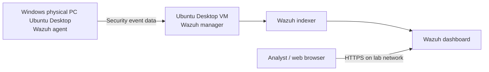

# Wazuh SOC Home Lab

> A beginner-friendly Blue Team project for monitoring a Windows endpoint using a Wazuh server hosted on an Ubuntu Desktop virtual machine.


## 1. Project overview

This project documents the design, installation, configuration, and testing of a small Security Operations Center (SOC) home lab. Wazuh collects and analyzes security events from a monitored endpoint. Its dashboard helps an analyst review alerts and investigate potentially suspicious activity.

**Project status:** [Completed]  
**Date:** [2026/10/13]  
**Author:** [Stelvio Dala & Angezett Chitue]  
**Purpose:** [Blue Team practice / Portfolio]

## 2. Objectives

- Build a virtualized security monitoring environment.
- Connect a Windows, Ubuntu Desktop endpoint to a Wazuh manager.
- Learn to inspect agent status and security alerts.
- Demonstrate at least one **authorized, harmless** detection test.
- Document the evidence, limitations, and troubleshooting steps.

## 3. Lab architecture



> In an all-in-one deployment, the manager, indexer, and dashboard run on the same Ubuntu VM. Adapt this diagram if your final architecture differs.

| Component | Role | Details |
|---|---|---|
| Physical computer | Host and monitored endpoint (agent) | Windows 11; 20 GB RAM / 1T SSD |
| VirtualBox | Virtualization | Version:7.2.18 |
| Ubuntu Desktop VM | Wazuh central components | Ubuntu version: 24.04.01; VM 8 RAM/ 6 CPU/ 80GB disk |
| Ubuntu Desktop VM | Monitored endpoint (agent) | Ubuntu version: 24.04.01; VM 4 RAM/ 6 CPU/ 80GB disk |
| Wazuh manager | Receives and analyzes agent events | Wazuh version: 4.14.8 |
| Wazuh indexer | Stores and indexes data | Installed on same VM |
| Wazuh dashboard | Visualizes events and alerts | Installed on same VM |
| Windows Wazuh agent | Collects endpoint telemetry | Wazuh agent version: 4.14.8 |
| Router / switch | Local network connectivity | [Describe only if used] |

**Network mode:** Bridged  
**Manager IP (example format only):** `192.168.x.x`  
**Dashboard:** `https://<MANAGER-IP>` (private lab access only)

## 4. Tools and technologies

| Tool | Why it is used |
|---|---|
| Wazuh | Endpoint monitoring, security event analysis, alerts |
| Ubuntu Desktop | Operating system for the monitoring server VM |
| Ubuntu Desktop | Monitored Ubuntu Desktop endpoint |
| Windows | Monitored physical endpoint |
| Oracle VirtualBox | Runs the Ubuntu VM |
| Windows Event Viewer | Confirms local Windows security events |
| GitHub | Publishes project documentation and evidence |

## 5. Setup and configuration

### Step 1 — Prepare the VM

1. Create an Ubuntu Desktop virtual machine in VirtualBox.
2. Assign appropriate RAM, CPU cores, and storage for your selected Wazuh release.
3. Configure the VM networking so the Windows agent can reach the manager.
4. Install Ubuntu and apply operating-system updates.
5. Record the Ubuntu IP address using:

```bash
hostname -I
```

**Evidence to add:** `screenshots/01-ubuntu-vm.png`

### Step 2 — Install Wazuh central components

Use the official Wazuh installation guide for the **exact version** installed in your lab:

https://documentation.wazuh.com/current/installation-guide/index.html

Download and run the Wazuh installation assistant:

```bash
curl -sO https://packages.wazuh.com/4.14/wazuh-install.sh && sudo bash ./wazuh-install.sh -a
```

Record the manager version: [add]  
Record any configuration changes you made: [add]

Check manager status:

```bash
sudo systemctl status wazuh-manager
```

**Evidence to add:** `screenshots/02-manager-status.png`

### Step 3 — Open and secure the dashboard

Open `https://<MANAGER-IP>` from a browser that can reach the VM. Sign in with the administrator account, then store the password **outside this repository**. Limit dashboard access to your trusted lab network.

**Evidence to add:** `screenshots/03-dashboard.png` (hide personal details)

### Step 4 — Install and enroll the Windows agent

In Wazuh, go to **Agents management → Summary → Deploy new agent**. Select Windows, set the manager address to your reachable VM address, and follow the generated instructions for your installed release.

Official Windows guide: https://documentation.wazuh.com/current/installation-guide/wazuh-agent/wazuh-agent-package-windows.html

After installation, run PowerShell as administrator:

```powershell
Start-Service wazuhsvc
Get-Service wazuhsvc
```

Check enrolled agents **on the Ubuntu Wazuh manager**:

```bash
sudo /var/ossec/bin/agent_control -l
```

Expected result: your Windows endpoint appears as **Active** after it has connected.

**Evidence to add:** `screenshots/04-agent-active.png`

### Step 5 — Record important configuration

| Setting | Value |
|---|---|
| Agent device name | [add] |
| Manager address used by the agent | [private IP or hostname; redact if necessary] |
| Agent connection status | [Active / other] |
| Config file (Ubuntu manager) | `/var/ossec/etc/ossec.conf` |
| Config file (64-bit Windows agent, default location) | `C:\Program Files (x86)\ossec-agent\ossec.conf` |

Do **not** upload your real `ossec.conf` without reviewing it. Use `configs/ossec-agent.example.xml` as a sanitized example instead.

## 6. Security monitoring / demonstration

Fill in the test table **after performing** a harmless, authorized exercise on your own endpoint:

| Test ID | Test scenario | Expected evidence | Actual result | Screenshot |
|---|---|---|---|---|
| T01 | Windows agent connects to manager | Agent shows Active | [Pass/Fail + notes] | `screenshots/04-agent-active.png` |
| T02 | Failed sign-in on a test Windows account | Windows security event (such as event ID 4625 when relevant auditing is enabled) | [Pass/Fail + notes] | `screenshots/05-test-alert.png` |
| T03 | Review an alert in dashboard | Timestamp, endpoint, rule, and event context visible | [Pass/Fail + notes] | `screenshots/06-alert-details.png` |

For each test, explain: **What did I do? What did Windows record? What did Wazuh show? What did I conclude?**

Only mark a test as passing when you actually observed its result. A Windows event does not guarantee a visible Wazuh alert without appropriate collection and rules.

More detailed test write-ups: [docs/security-tests.md](docs/security-tests.md).

## 7. Findings and limitations

**Findings:**
- [Describe a real alert you investigated.]
- [Describe what the agent successfully collected.]

**Limitations:**
- [Example: agent disconnected when the server address changed between networks.]
- [Example: the lab currently contains only one monitored endpoint.]
- [Explain anything planned but not yet implemented.]

## 8. Troubleshooting

| Problem | What I checked | Resolution / status |
|---|---|---|
| Agent disconnected | VM IP, network mode, agent's manager address, services | [Your actual fix] |
| Dashboard inaccessible | VM address, connectivity, service status, firewall | [Your actual fix] |
| Agent does not appear | Agent service, manager logs, enrollment, connectivity | [Your actual fix] |

See [docs/troubleshooting.md](docs/troubleshooting.md) for commands and detailed notes.

## 9. Lessons learned

Write 3–5 short points in your own words:

- [How the Wazuh manager and agent communicate.]
- [Why networking matters when moving the lab to a different Wi-Fi network.]
- [How an analyst validates a security event instead of assuming an alert is an attack.]
- [What you would change for a larger lab.]

## 11. Repository structure

```text
wazuh-soc-home-lab/
├── README.md
├── docs/
│   ├── installation.md
│   ├── security-tests.md
│   └── troubleshooting.md
├── configs/
│   └── ossec-agent.example.xml
└── screenshots/
    ├── 01-ubuntu-vm.png           # add your image
    ├── 02-manager-status.png      # add your image
    ├── 03-dashboard.png           # add your image
    ├── 04-agent-active.png        # add your image
    ├── 05-test-alert.png          # add your image
    └── 06-alert-details.png       # add your image
```

## 12. References

- [Wazuh installation guide](https://documentation.wazuh.com/current/installation-guide/index.html)
- [Wazuh agent installation](https://documentation.wazuh.com/current/installation-guide/wazuh-agent/index.html)
- [Wazuh agent connection and status](https://documentation.wazuh.com/current/user-manual/agent/agent-management/agent-connection.html)

---

**Safety and scope:** All demonstrations must be conducted on systems you own or are explicitly authorized to test. This repository documents a small educational lab, not a claim of production security coverage.
